# Camera-Radar Fusion for Roadside Perception

Late fusion of a YOLOv8 camera detector and an automotive radar, on the public [INFRA-3DRC dataset](https://github.com/FraunhoferIVI/INFRA-3DRC-Dataset). Every moving road user the camera finds gets the radar's range and radial speed, and is tracked over time.

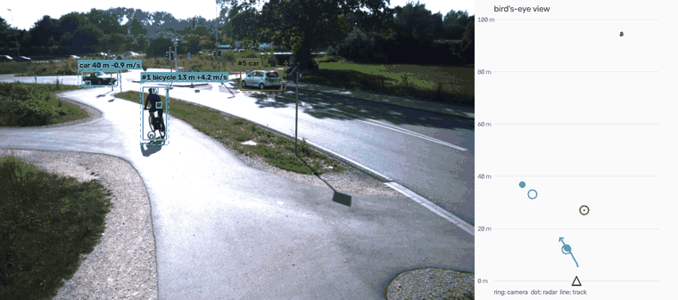

*Left: camera detections with track ID (solid box), the 20% tolerance region used for matching (dashed), raw radar returns (red triangles) and the radar cluster matched to each box (dot). Right: the same objects from above: camera estimate as a ring, radar as a dot, track history as a line and the tracked velocity as an arrow (1 s ahead).*

## How it works

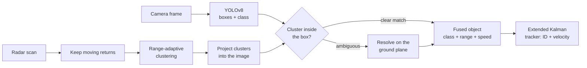

1. **Detect.** YOLOv8 finds adults, bicycles, motorcycles, cars and buses in the camera image.

2. **Cluster.** Moving radar returns are grouped into objects. Returns get sparser with distance, so a fixed neighbourhood either splits far objects or merges near ones; the neighbourhood here grows with range.

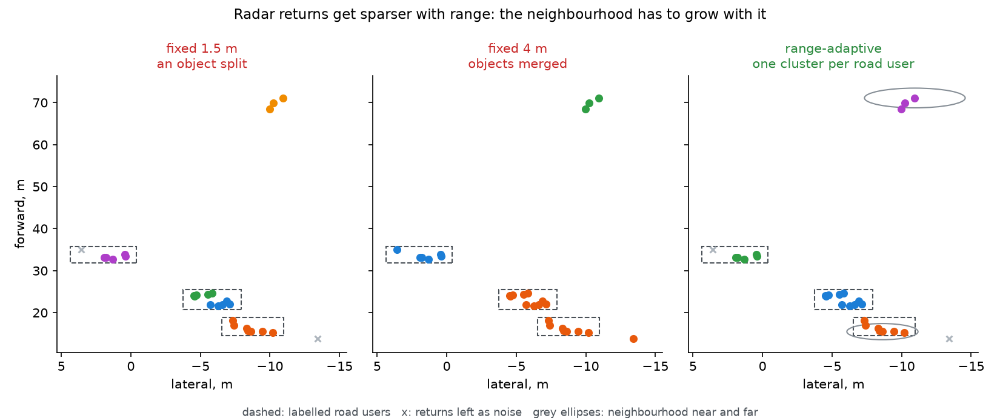

3. **Associate.** A cluster is a candidate for a box when its projected centre falls inside the box, widened by 20% for calibration error. Ambiguous cases are resolved on the ground plane:

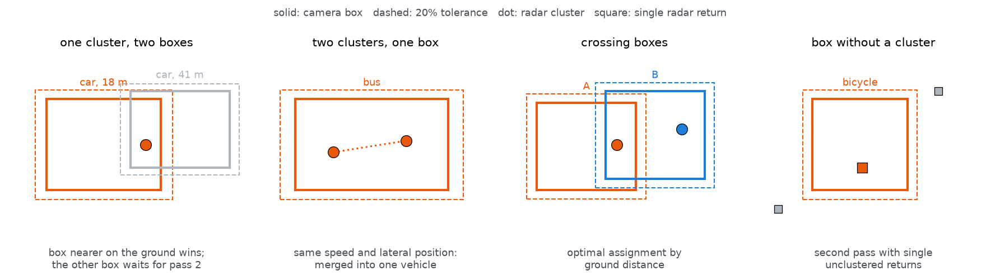

4. **Track.** An extended Kalman filter per object, with position and velocity on the ground plane. A fused object updates its track with what the radar measures: range, azimuth and range rate (Doppler). These relate nonlinearly to the state, so the filter linearises them at every update. Objects without radar fall back to the camera's ground estimate, which drifts by metres at range (left). Doppler observes speed directly, so a new track has its speed from the first radar frame instead of differentiating positions (right).

<p align="center">
  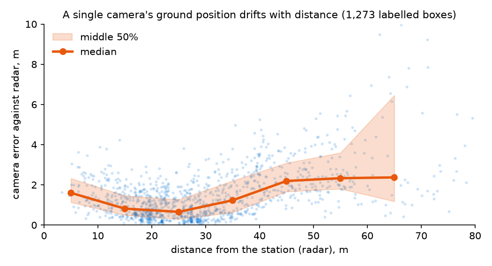
  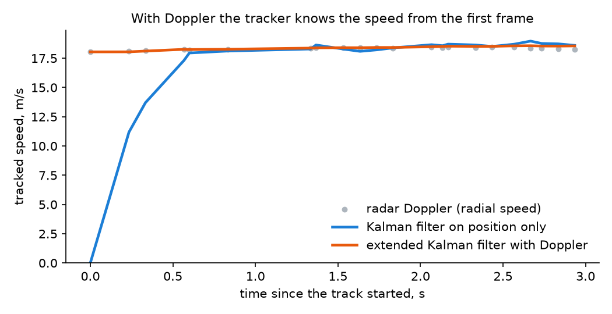
</p>

Tracks are matched to detections with the Hungarian algorithm on Mahalanobis distance, get an ID after 3 hits and survive 5 missed frames.

## Across scenes

Three sensor setups at the same Ingolstadt site, day, twilight and night, and every road-user class in the dataset.

<table>
  <tr>
    <td width="50%">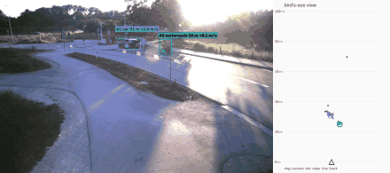<br><sub>Day: a car and a motorcycle crossing</sub></td>
    <td width="50%">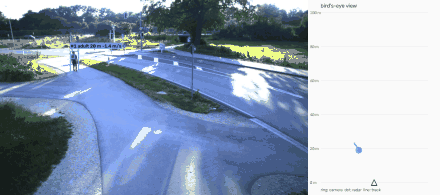<br><sub>Day: a pedestrian crossing</sub></td>
  </tr>
  <tr>
    <td>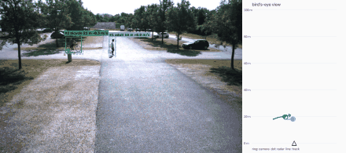<br><sub>Day, second setup: a pedestrian and a cyclist</sub></td>
    <td>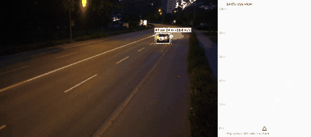<br><sub>Twilight: a bus and two cars</sub></td>
  </tr>
  <tr>
    <td>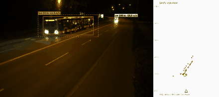<br><sub>Night: two buses and two cars</sub></td>
    <td>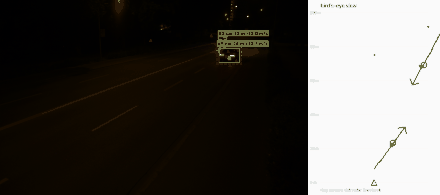<br><sub>Night: cars in opposite directions</sub></td>
  </tr>
</table>

## Quick start

```bash
git clone https://github.com/DkPanseriya/Sensor-Data-Fusion.git
cd Sensor-Data-Fusion
git lfs pull                        # the three detector checkpoints
pip install -r requirements.txt
```

Download [INFRA-3DRC](https://github.com/FraunhoferIVI/INFRA-3DRC-Dataset) and put the scene folders in `Dataset/INFRA-3DRC-Dataset/`. Then:

```bash
python run_fusion.py --scene Dataset/INFRA-3DRC-Dataset/INFRA-3DRC_scene-09 --save fusion.mp4
```

`--show` opens a live window, `--save` also takes `.gif` or a folder, `--model` picks a checkpoint, `--no-tracking` fuses frames independently. `python run_fusion.py --help` lists the rest.

## Fusion and tracking results

INFRA-3DRC labels every camera box and every radar point with a track ID, the same ID for the same road user in both sensors. `tools/evaluate_fusion.py` uses that to score the pipeline over all 22 scenes (2,484 frames, 3,880 labelled boxes):

| Detections | Association precision | Association recall | ID switches | IDF1 |
|---|---|---|---|---|
| YOLOv8n | 97.8% | 92.2% | 52 | 0.89 |
| labelled boxes | 97.7% | 92.0% | 55 | 0.90 |

Association precision: of the boxes that got radar, the share that got the radar points of the same road user. Recall: the share of boxes with moving radar returns that got them. IDF1 measures how consistently a track keeps one road user's identity. The run with labelled boxes isolates fusion and tracking from detector errors.

```bash
python tools/evaluate_fusion.py --dataset Dataset/INFRA-3DRC-Dataset --model models/yolov8n.pt   # omit --model to use labelled boxes
```

## Detector training

Cars dominate INFRA-3DRC: 2,040 training boxes against 64 motorcycles. Trained on that, a detector learns the rare classes weakly, so they were upsampled. Training frames with a motorcycle were copied with the car blurred out and its label removed, so motorcycles gained examples and cars did not. Each copy also got a photometric change. Buses and bicycles were upsampled the same way, to a lesser degree. Only training frames were copied, never validation frames.

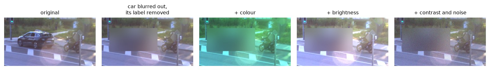

<p align="center">
  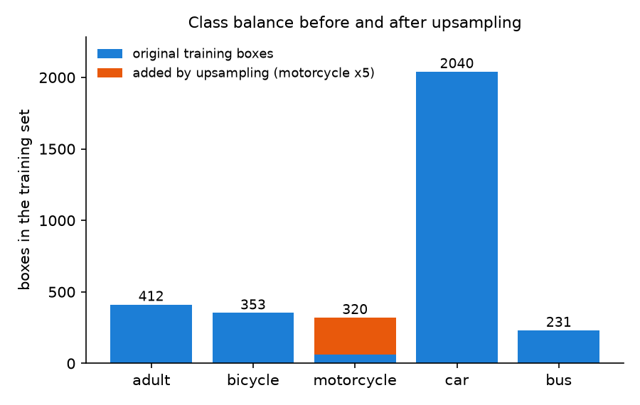
  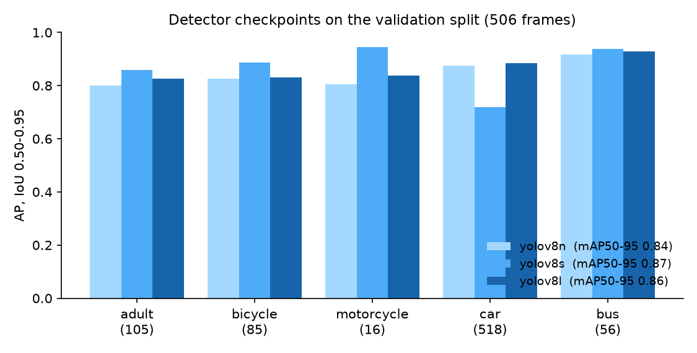
</p>

Every class is checked on its own, not only the average: AP over IoU 0.50 to 0.95 lies between 0.72 and 0.95 for every class and model size (`tools/evaluate_detector.py`, COCO-style). The small model's weaker car score matches its training log, where car recall was 0.75.

Two cautions. The validation frames are a random 20% of each scene, so neighbouring frames sit in training and validation, and these numbers measure fit to this site rather than performance on new scenes. And a large model trained without the upsampled copies scored the same per class on this split, so the split cannot show what upsampling buys on new data; holding out whole scenes can:

```bash
python tools/prepare_dataset.py --dataset Dataset/INFRA-3DRC-Dataset --out data/yolo \
    --val-scenes INFRA-3DRC_scene-09 INFRA-3DRC_scene-20 INFRA-3DRC_scene-22 --upsample motorcycle=4 bus=1 bicycle=1
yolo train model=yolov8n.pt data=data/yolo/data.yaml epochs=300
python tools/evaluate_detector.py --data data/yolo --models runs/detect/train/weights/best.pt
```

Motorcycles appear in one scene only, so a scene split cannot validate that class. `--val-list tools/splits/original_val.txt` rebuilds the split the shipped checkpoints were trained with.

## Repository

```
run_fusion.py            run the pipeline on a scene
fusion/                  pcd reader, calibration, clustering, association, tracking, rendering
tools/                   dataset preparation, detector and fusion evaluation, README figures
models/                  YOLOv8 n / s / l checkpoints (Git LFS)
tests/                   unit tests: python -m pytest
```

## Limitations

- The camera's ground mapping is off by 1 to 3 m (figure above), so matching happens in the image and ground distance only breaks ties.
- The motion model is constant velocity, so turning vehicles lag slightly until the filter catches up.
- Radar returns slower than 0.1 m/s are dropped as static clutter, so road users that stand still get the camera's position only.
- All scores come from one roadside site (three sensor setups); the shipped detectors have also seen frames from every scene in training.

## Credits

A student team project at Fraunhofer IVI (2024). I led the team and the technical work. The extended Kalman tracker, the association and tracking evaluation and the current code structure were added in 2026.

- Dataset: INFRA-3DRC by Fraunhofer IVI, CC BY-NC 4.0 (non-commercial). It is not redistributed here.
- Detector: [Ultralytics YOLOv8](https://github.com/ultralytics/ultralytics), AGPL-3.0. The checkpoints are trained on INFRA-3DRC and inherit its non-commercial terms.
- Code in this repository: MIT.
