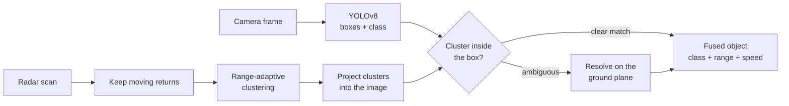

# Camera-Radar Fusion for Roadside Perception

Late fusion of a YOLOv8 camera detector and an automotive radar, on the public [INFRA-3DRC dataset](https://github.com/FraunhoferIVI/INFRA-3DRC-Dataset). Every road user the camera finds gets the radar's range and speed.


*Left: camera detections (solid box), the 20% tolerance region used for matching (dashed), raw radar returns (red triangles) and the radar cluster matched to each box (dot). Right: the same objects from above, camera estimate as a ring, radar as a dot.*

## How it works



1. **Detect.** YOLOv8 finds adults, bicycles, motorcycles, cars and buses in the camera image.
2. **Cluster.** Moving radar returns are grouped into objects. The neighbourhood grows with range, because returns get sparser with distance.
3. **Associate.** A cluster is a candidate for a box when its projected centre falls inside the box. Ambiguous cases are resolved by distance on the ground plane:

| Case | Resolution |
|---|---|
| one cluster, one box | match |
| one cluster in several boxes | the box nearest to the cluster on the ground |
| several clusters in one box | clusters with similar speed and lateral position are merged into one vehicle; the nearest group wins |
| several clusters, several boxes | optimal assignment by ground distance |
| box with no cluster | second pass against single radar returns the clustering left out |

## Quick start

```bash
git clone https://github.com/DkPanseriya/Sensor-Data-Fusion.git
cd Sensor-Data-Fusion
git lfs pull                        # the three detector checkpoints
pip install -r requirements.txt
```

Download [INFRA-3DRC](https://github.com/FraunhoferIVI/INFRA-3DRC-Dataset) and put the scene folders in `Dataset/INFRA-3DRC-Dataset/`. Then:

```bash
python run_fusion.py --scene Dataset/INFRA-3DRC-Dataset/INFRA-3DRC_scene-09 --save fusion.mp4
```

`--show` opens a live window, `--save` also takes `.gif` or a folder, `--model` picks a checkpoint. `python run_fusion.py --help` lists the rest.

## Detector results


Three YOLOv8 sizes, evaluated with `tools/evaluate_detector.py` (COCO-style matching, AP averaged over IoU 0.50 to 0.95; mAP@50 is 0.97 to 1.00 for all three). The validation frames are a random 20% of each scene, so neighbouring frames of the same scenes sit in training and validation: read these as fit to this station, not as performance on new scenes. For a cleaner split, hold out whole scenes (see below).

## Train your own detector

```bash
python tools/prepare_dataset.py --dataset Dataset/INFRA-3DRC-Dataset --out data/yolo --val-scenes INFRA-3DRC_scene-09 INFRA-3DRC_scene-15
yolo train model=yolov8n.pt data=data/yolo/data.yaml epochs=300
python tools/evaluate_detector.py --data data/yolo --models runs/detect/train/weights/best.pt
```

`--val-list tools/splits/original_val.txt` rebuilds the split the shipped checkpoints were trained with.

## Repository

```
run_fusion.py            run the pipeline on a scene
fusion/                  pcd reader, calibration, clustering, association, rendering
tools/                   dataset preparation and detector evaluation
models/                  YOLOv8 n / s / l checkpoints (Git LFS)
tests/                   unit tests: python -m pytest
```

## Limitations

- The camera's ground-plane mapping and the radar's ground position disagree by about 2 m in this calibration, so matching happens in the image and ground distance only breaks ties.
- Each frame is fused on its own; there is no tracking over time.
- The dataset does not link camera and radar labels, so the fusion is judged visually, not scored.

## Credits

A student team project at Fraunhofer IVI (2024). I led the team and the technical work.

- Dataset: INFRA-3DRC by Fraunhofer IVI, CC BY-NC 4.0 (non-commercial). It is not redistributed here.
- Detector: [Ultralytics YOLOv8](https://github.com/ultralytics/ultralytics), AGPL-3.0. The checkpoints are trained on INFRA-3DRC and inherit its non-commercial terms.
- Code in this repository: MIT.
